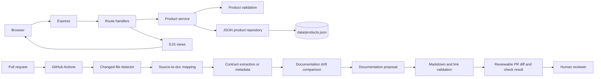

# Proposed Architecture: Automated Documentation Sync Capstone

**Status:** Approved architecture baseline; implementation completed for the initial application and sync workflow.

This proposal is based on `docs/requirements.md`, which is itself marked proposed. It recommends an architecture without implementing application code. Requirements and design decisions left open are called out explicitly.

## 1. Architecture Recommendation

Use a modular Node.js application with Express.js and EJS for the server-rendered product website, a JSON-file repository for product persistence, and GitHub Actions for pull-request documentation checks.

This combination matches the learning prototype's stated preferences while keeping the application small. Express provides routing and middleware; EJS renders pages on the server without requiring a client-side framework; JSON persistence satisfies the local-file requirement. GitHub Actions is a natural fit for checks triggered by pull-request events.

Keep the website and documentation-sync workflow as separate components. The website should run independently of the sync tooling. The sync workflow operates on repository changes and produces reviewable documentation changes.

The project owner approved Node.js, Express.js, EJS, and GitHub Actions for this implementation. Other deployment or CI providers remain out of scope for this prototype.

## 2. Components and Responsibilities

| Component | Responsibility |
| --- | --- |
| Express application | Accept browser requests, apply request handling, select routes, render EJS pages, and return required status codes or redirects. |
| Route handlers | Translate requests into product operations and select the appropriate page, status, or redirect response. |
| Product validation | Trim text; validate non-empty names and positive INR prices with at most two decimal places; return useful validation errors. |
| Product service | Coordinate validation and repository operations for create, read, update, and delete. |
| JSON product repository | Load and persist products in `data/products.json`; handle first-run initialization and storage failures. |
| EJS views | Render the catalogue, product details, forms, deletion confirmation, and visitor-safe error pages. |
| Documentation contract and mapping | Associate relevant source areas or structured contracts with the documentation they affect. |
| Sync checker | Inspect pull-request changes, detect relevant source changes, compare expected documentation with committed documentation, and report drift. |
| Documentation renderer and validator | Produce candidate documentation changes and check Markdown structure and local links. |
| Pull-request workflow and reviewer | Run read-only checks, publish a candidate patch artifact, and require human application/review before merge. |

## 3. E-Commerce Application Flow

A browser request enters Express and is matched to a route. The handler calls the product service. The service validates submitted data where applicable and uses the repository for reads or writes. The handler then renders an EJS view or returns a redirect.

- Successful catalogue, detail, form, or deletion-confirmation pages return `200 OK`.
- Malformed and unknown product IDs return `404 Not Found`.
- Invalid form submissions return `422 Unprocessable Content` with useful feedback; invalid changes are not persisted.
- Successful create, update, and delete operations persist first, then return `303 See Other` to a relevant page.
- Storage failures return a generic `500 Internal Server Error`; diagnostic details are logged server-side and not shown to visitors.
- Deletion is preceded by a confirmation page and user action.

The implemented route paths and methods are documented in `docs/routes.md` and are registered from the route contract in `docs-sync/contracts/routes.json`.

## 4. Product JSON Storage

The JSON repository is the only application component that directly accesses `data/products.json`. It loads and parses the file, provides product lookup and mutation operations, and persists changes.

- A missing file is initialized as an empty product list.
- Malformed or unreadable JSON is reported as a storage error and is not silently overwritten.
- Product changes are persisted before the application reports success.
- Write failures are treated as storage failures.

As implementation recommendations, serialize writes within the process and write to a temporary file before replacing the data file. This reduces the chance of overlapping writes or a partially written JSON file; it does not provide multi-process coordination, which is not required.

The product ID is a UUID string. Prices are stored as decimal strings containing integer paise in `pricePaise` and converted exactly to/from INR decimal form values. Blank optional fields are omitted from JSON records. These choices avoid floating-point rounding and follow the approved product-data decision.

## 5. Source-Change Detection and Documentation Mapping

Use a deterministic, contract-based sync pipeline rather than relying on generated text alone as its source of truth. Maintain a version-controlled mapping from source areas to documentation and validation evidence. The initial proposed mapping is:

| Source area | Affected documentation | Evidence used |
| --- | --- | --- |
| Express route registrations and route handlers | `docs/routes.md` | Extracted route contract plus integration tests for actual status codes and redirects. |
| Product model and validation | Product-data documentation | Normalized product schema and validation rules plus unit and integration tests. |
| JSON repository and storage error handling | Product-data and error-handling documentation | Repository contract plus persistence and storage-failure integration tests. |
| Startup scripts, runtime configuration, and documented environment variables | Project setup documentation | Script/configuration metadata and setup validation. |

The workflow should:

1. Run when a pull request is opened or updated. Compare its changed paths with the base branch, including additions, modifications, deletions, and renames. A rename is evaluated as both removal of the old path and addition of the new path.
2. Apply the maintained mapping to identify all documentation and validation checks affected by changed source. When a relevant change has no mapping, fail the check with an actionable unmapped-change finding. Changes outside the declared scope do not require documentation updates.
3. For mapped areas, obtain a normalized representation from source metadata or explicit contracts. The representation must include the documentation-relevant facts, such as route method/path/purpose/inputs/responses or product fields and validation rules.
4. Compare the normalized representation with the corresponding documented content using stable, deterministic generated sections or structured values. Avoid fuzzy prose similarity as the pass/fail mechanism. A mismatch, missing mapped documentation, or deleted documentation is drift.
5. Validate the source of truth against actual application behavior. Unit and integration tests must assert that runtime routes, responses, validation, and persistence match the metadata/contracts used to produce documentation. Passing comparison alone is insufficient.
6. If extraction, mapping, comparison, or runtime evidence is missing or fails, report the change as unresolved and fail the check. Do not infer or silently accept the correct documentation.

The source-to-document map and contracts are maintained in `docs-sync/source-map.json` and `docs-sync/contracts/`. The mapping itself is validated by tests and identifies the documentation, contract, and runtime evidence associated with each relevant source area.

## 6. Documentation Generation, Validation, and Review

When drift can be corrected from reliable metadata, generate a focused documentation patch using deterministic templates or rendering of structured contracts. Restrict generated output to an allowlist of documentation paths, validate all paths as repository-relative, and reject any generated diff that touches source code, workflow files, or other non-documentation paths. Do not allow generated content to execute as code.

Validate the candidate documentation for basic Markdown structure and local links, then rerun the deterministic drift comparison against the candidate. The workflow presents the exact proposed diff, affected source changes, validation results, and unresolved findings for human review. It must not merge changes automatically or write to the main branch. A human reviews and approves documentation changes before merge.

Define explicit check outcomes: pass when no mapped documentation is affected or all affected docs match and validation succeeds; fail with actionable findings for detected drift, unresolved changes, missing evidence, or checker/validator failures. Partial or incomplete proposals do not count as successful updates and are discarded or clearly marked as incomplete.

The implemented GitHub Actions workflow runs read-only for pull requests from both the same repository and forks. It publishes `documentation-review.json` as a workflow artifact containing proposed documentation diffs and findings for a human to apply and review. The workflow does not write to a pull-request branch, push, or merge. This avoids exposing write credentials to untrusted PR code.

### Pull-request security boundary

Pull requests from forks cannot safely be given write credentials in an ordinary untrusted PR workflow. Run checks read-only against PR code. The fork flow should publish a patch artifact or suggested diff for a human to apply. Any automated write path for same-repository PRs must be separately gated, narrowly scoped, and isolated from execution of untrusted PR code.

No automated same-repository write mechanism is implemented. Any future write mechanism requires a separate security review and must not expose credentials to untrusted PR code.

## 7. Error Handling, Security, and Testing

### Error handling

- Return the required browser-facing status codes and redirects.
- Keep visitor-facing storage errors generic; log diagnostic details server-side.
- Do not silently repair or overwrite malformed JSON.
- Ensure failed writes are not reported as successful product changes.
- If the product file is malformed or unreadable, keep the server running; requests requiring product storage return a generic `500` response. Log diagnostic details and preserve the original file. This is the selected behavior for this proposal and should be covered by integration tests.
- If a synchronization step, mapping lookup, extraction, comparison, or documentation validator fails, fail the relevant PR check with actionable diagnostics. Do not treat infrastructure or tooling failure as a clean result.

### Security considerations

- Bind the local development server to loopback (`127.0.0.1`) to honor localhost-only use; do not expose unauthenticated product management on a network interface.
- Use EJS escaped output for user-provided values. The absence of image URL validation does not justify inserting raw user input into HTML.
- State-changing forms validate the `Origin` header, falling back to `Referer`; the source must be HTTP and use `localhost` or `127.0.0.1` on the server's local port.
- Keep the storage path fixed rather than deriving it from request input.
- Apply least-privilege permissions to CI workflows and do not expose write credentials to untrusted pull-request code.
- Treat generated documentation as a proposal that requires human review.
- Restrict generated diffs to an allowlist of documentation paths and reject unexpected file changes before proposing or applying a patch.

### Testing strategy

- Unit tests: product input validation, normalization, and any price conversion.
- Integration tests: CRUD behavior, required response codes and redirects, persistence after restart, and missing/malformed/unreadable/unwritable storage cases.
- Sync tests: fixtures covering relevant source changes, matching and drifting documentation, uncertain changes, malformed Markdown, and broken local links.
- Workflow-level verification: demonstrate that drift blocks the pull request, corrected documentation is reviewable, and all documentation checks run.

## 8. Component Diagram

## 9. Data-Flow Diagram

```mermaid
flowchart TD
    subgraph Website
        A[Browser form or page request] --> B[Express route]
        B --> C{Operation}
        C -->|Create or update| D[Validate and normalize input]
        D -->|Invalid| E[Render errors with 422]
        D -->|Valid| F[Product service]
        C -->|Browse, detail, delete confirmation| F
        F --> G[JSON repository]
        G --> H[(data/products.json)]
        H --> G
        G -->|Missing ID| I[404 response]
        G -->|Storage failure| J[Generic 500 and server log]
        G -->|Success| K[Render page or 303 redirect]
    end

    subgraph DocumentationSync
        L[PR opened or updated] --> M[Compare base and PR changes]
        M --> N{Relevant source change?}
        N -->|No| O[No documentation update required]
        N -->|Yes| P[Map changed source to docs]
        P --> Q[Extract or generate expected documentation]
        Q --> R{Confident result?}
        R -->|No| S[Flag unresolved drift; fail check]
        R -->|Yes| T[Compare with committed docs]
        T --> U{Drift found?}
        U -->|No| V[Run Markdown and local-link checks]
        U -->|Yes| W[Propose PR-branch documentation diff]
        W --> V
        V --> X{All checks pass?}
        X -->|No| Y[Fail check with findings]
        X -->|Yes| Z[Human review before merge]
    end
```

## 10. Mapping to Requirements

| Requirement area | Architecture response |
| --- | --- |
| Server-rendered catalogue and product details | Express routes, product service, and EJS views. |
| Product CRUD and deletion confirmation | Route handlers coordinate service operations; deletion requires a confirmation step. |
| Product fields and validation | Dedicated validation component; UUID generated at creation; INR validation at the form boundary. |
| Required response behavior | Handlers return `200`, `404`, `422`, `303`, or generic `500` as specified. |
| JSON persistence | Repository owns `data/products.json`, missing-file initialization, and storage error handling. |
| Restart persistence | Repository persists mutations; integration tests restart the app and verify data remains. |
| Documentation coverage | Route inventory plus product-data and setup documentation mapped to relevant source areas. |
| PR-triggered drift checks | GitHub Actions compares changed source with mapped docs on PR open/update. |
| Proposed updates and human review | Sync produces a reviewable PR diff; merge is never automatic. |
| Uncertain changes | Report unresolved drift and fail the check rather than guessing. |
| Markdown and local links | Dedicated documentation validation step in the sync workflow. |
| Localhost-only prototype | Bind to loopback; no authentication or network-accessible use is assumed. |
| Test evidence | Unit, integration, sync-fixture, and workflow-level checks cover acceptance criteria. |

## 11. Open Decisions and Uncertainties

- `docs/requirements.md` remains labeled proposed and should be formally approved or revised before future scope changes; implementation did not silently alter it.
- A human must apply and review the JSON proposal artifact; automated PR-branch writes are not supported.
- The contract extractor currently supports the versioned JSON contracts and generated sections documented in `docs-sync/`; new source areas need explicit mappings and contracts.
- The hosted GitHub Actions workflow must be observed after push; local tests validate its configuration and the underlying commands, not GitHub's hosted execution.

## 12. Review and Approval

This architecture records the implemented design and its remaining operational risks. Future changes should maintain consistency with `docs/requirements.md`, the contracts under `docs-sync/contracts/`, and their mapped runtime tests.